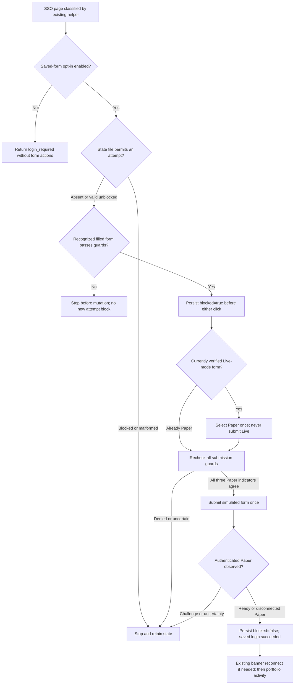

# Guarded Saved-Form Paper Sign-In

Owner-authorized and enabled October 16, 2026 on Windows VM 104. The owner
explicitly requested automatic Paper selection and submission using credentials
already filled by Chrome after the apparent overnight logout. This is a narrow
extension of the existing helper, not an autonomous research agent or order flow.

This guide is the implementation and operating contract, including diagrams,
every saved-login reason, state retention, test coverage and the actual live
verification. For the whole trading system and daily timeline, start with
[System overview](SYSTEM_OVERVIEW.md). For subscription/client changes, use
[Monitor migration](BROWSER_MONITOR_MIGRATION.md); do not create another monitor
just because this guide is read by a different model.

## What Runs

The same active `ibkr-paper-browser-check` heartbeat runs every 40 minutes, 24/7:

```text
Windows VM 104: browser_research.py keepalive
  -> independent analysis-task health check
  -> shared browser lock, dedicated-profile recovery and Paper classification
  -> ready Paper: existing Positions / Dashboard activity
  -> disconnected Paper: existing guarded banner reconnect, if enabled
  -> SSO login page: saved-form recovery below, if enabled
  -> deduplicated Telegram health notices and safe monitor history
```

No new schedule, Windows task, model, API credential or password store was added.
OpenClaw supplies its existing browser-control CLI on VM 105; an LLM does not
choose controls or receive credentials. Authentication failures never stop
independent news/market analysis or public MX/Barchart research.

The deployed command is the project's existing venv on **Windows VM 104**:

```powershell
Set-Location C:\Trading
C:\Trading\.venv\Scripts\python.exe C:\Trading\browser_research.py keepalive
```

This is a production command: it may recover Chrome, submit the enabled saved
Paper form, navigate and send Telegram health notices. It is not a documentation
check or a passive status read. Adding `--no-notify` suppresses both task-health
and Paper-health Telegram sends, **not** authentication, navigation or state writes.

## Configuration And Scope

`OPENCLAW_PAPER_SAVED_LOGIN` defaults **false** in code and `.env.example`.
Production `.env` was set **true** for this request. A new helper process loads
the flag; neither Chrome nor OpenClaw needs restarting. Set it false to disable
this recovery without disabling research, ordinary activity or the separate
`OPENCLAW_PAPER_RECONNECT` banner flow.

Only `canadian-stocks` is operated. The helper uses the already-existing IBKR
tab classified as an SSO login page; it does not open another authentication tab,
log out a connected session, change Chrome autofill settings, choose a saved
password entry or interact with a password-manager popup. Both fields must
already be populated. Missing values require owner attention.

Within the page, the guard checks only whether the username/password fields are
nonempty. No field value is returned through the control API to Python, printed,
stored in this project, or sent to a model/Telegram. The site's own recognized
form sends the existing values to IBKR as part of normal authentication; that is
the owner's authorized destination, not a claim that login makes no network request.
Chrome's pre-existing credential storage remains unchanged.

| Switch | Code/template default | Documented deployment decision | Independent effect |
|---|---|---|---|
| `OPENCLAW_KEEPALIVE_ENABLED` | true | Enabled | If false, skip the Paper check/recovery; the CLI still reads analysis-task health first |
| `OPENCLAW_PAPER_SAVED_LOGIN` | false | Owner enabled October 16 | Permit only this saved-form SSO recovery |
| `OPENCLAW_PAPER_RECONNECT` | false | Owner enabled October 11 | Permit only the separate disconnected-Paper banner reconnect |
| `OPENCLAW_BROWSER_AUTORESTART` | true | Existing scoped recovery retained | May reopen a confirmed-closed dedicated Chrome, not authenticate by itself |
| `OPENCLAW_RESEARCH_ENABLED` | true | Existing research retained | Public evidence collection, not a switch enabling login |

These are dated configuration decisions, not a live reinspection each time the
document is opened. Existing process-environment values take precedence over
dotenv values. Edit only the intended flag privately; never print or overwrite
the whole `.env`, replace it with the example or put a broker password there.

The guard does not pin a particular username/account ID: it uses the fields
Chrome already populated in the owner's dedicated profile and enforces Paper
mode. It does not select an account from a password-store list. Changing which
account Chrome fills requires owner review; Paper-mode verification is not
verification of a real-account portfolio or of a particular account's identity.

## Guards And One-Attempt Limit

1. The existing helper holds its shared lock and has verified dedicated control.
2. Require HTTPS on the IBKR host/suffix, the top-level `/sso/Login` route, and
   exactly one recognized visible `xyzform-username` login form.
3. Require the observed username/password controls, Paper switch and associated
   label. Reject disabled fields, duplicate/unknown controls and missing values.
4. Require same-origin `/sso/Dispatcher` or the observed empty-action/current
   `/sso/Login` variant, POST, same-window submission and no
   button destination overrides. Reject challenges, active dialogs, credential
   rejection/lockout messages and explicit competing-session prompts.
5. Recognize Live only as a state from which to select **Paper**, never as a
   submission target. Require the checkbox, matching accessible mode announcement
   and matching button text to agree. Exactly one mode announcement may match.
6. Read `logs/browser_paper_login_state.json`. Malformed/unreadable state or
   `blocked=true` denies the attempt. Atomically persist `blocked=true` **before
   either click**. A state-write failure prevents all clicks.
7. If necessary, recheck all guards and click only the Paper switch's label.
   Recheck again before submission: checkbox checked, announcement
   `Paper trading mode selected`, and button `Simulated Login` are all mandatory.
8. Check that the control is visible, enabled and unobstructed. Each action runs
   synchronously with its DOM guards in one non-retried evaluation. Never type,
   select Live, blindly retry an uncertain click or submit a plain Live `Login`.
9. Observe the result within a 100-second sub-budget and the existing 240-second
   helper budget, with at most four observations and no resubmission. Authenticated
   `ready` or `paper_disconnected` with the Paper banner confirms sign-in, clearing
   this attempt block. A disconnected brokerage session then uses the independently
   enabled/blocked banner-reconnect flow; sign-in success is not quote readiness.
10. A failure, unknown page, challenge or timeout leaves the block in place.
    A later verified ready Paper observation can clear it after owner intervention.
    Never delete/reset this state to force retries. The helper does not accept
    confirmations, handle two-factor/CAPTCHA, reset credentials or place orders.

The login state contains only `blocked` and UTC `checked_at`. Keep it with the
separate banner-reconnect, browser-health, recovery and analysis-health state
during migrations. Missing credentials or an initial guard denial make no click
and do not create an attempt block; later autofill can then make a check eligible.

## State And Attempt Lifecycle



There is no retry edge from a failed submission back to the Login button.
The following table also defines recovery across process restarts:

| Stored/observed state | Meaning | Next automatic behavior |
|---|---|---|
| No login-state file | No persisted attempt is recorded | An eligible filled form may make its first attempt |
| Valid `blocked=false` | Last recorded episode was resolved/available | A later eligible SSO episode may attempt again |
| Valid `blocked=true` | Recovery started; its final outcome is not resolved as verified Paper | Deny another saved-form mutation, including after process restart or date rollover |
| Unreadable/malformed file | Cannot safely authorize another attempt | Stop; do not interpret it as absent or unblocked |
| Verified authenticated Paper after submission | Paper sign-in succeeded; brokerage may still be disconnected | Write unblocked state; any banner reconnect keeps its own guards/block |
| Later helper observes ready Paper after owner intervention | Previous uncertainty is resolved by an authenticated observation | `clear_verified()` may clear the saved-login block |

The state example below shows only its schema, not a command to write/reset it:

```json
{"blocked": true, "checked_at": "2026-10-17T05:00:00+00:00"}
```

State writes use a temporary sibling file and atomic replace while the shared
browser lock is held. This is persistent attempt coordination, not a transactional
broker ledger or a guarantee against disk/power-loss corruption. Failed or
uncertain actions are never fixed by deleting the file. Disabling/re-enabling
the flag, changing models or crossing midnight does not authorize a retry.

## Function-Level Walkthrough

| Location | Responsibility and boundary |
|---|---|
| `browser_research.py` CLI | Loads the existing private configuration, emits analysis-task health first, then invokes the Paper check; no catch-up job is launched |
| `check_paper_session()` | Shared lock, helper invocation, minimal health-state writes, notice deduplication and history |
| `CanadianResearchBrowser.keepalive()` | Recovery/classification, optional saved-form flow, optional banner flow, then verified portfolio activity |
| `paper_session()` | Classifies `/sso/` as login-required without reading field values; authenticated pages require the Paper banner |
| `paper_login.attempt()` | Rechecks opt-in, reads attempt state, applies the sub-deadline and orchestrates at most one recovery flow |
| `paper_login.PROBE` | Code-owned DOM guard; inspects presence/mode and, only for a requested allowed action, performs the guarded click synchronously |
| `paper_login.probe()` | Returns only recognized safe fields/reasons; actions use `_command_once()`, never the observation retry wrapper |
| `paper_login._write_state()` | Atomically persists only blocked flag and UTC check time before UI mutations or after verified Paper |
| `paper_login.clear_verified()` | Resolves an existing block only when called after verified Paper; it is not an operator reset command |
| Existing `_reconnect_paper()` | Separate warning-bound Log In flow for an authenticated but disconnected Paper portal |
| Existing `_portfolio_navigation()` | Observed real mouse clicks to Positions and Dashboard, separately verified; not the saved-form click implementation |
| `CanadianResearchBrowser.run_research()` | Public collection, cleanup in `finally`, then Paper activity when ready; it never calls the saved-form sign-in flow |

Source: [paper_login.py](../paper_login.py),
[browser_research.py](../browser_research.py),
[analysis_health.py](../analysis_health.py).
Both saved-form and banner clicks are guarded synchronous DOM evaluations;
ordinary keepalive portfolio activity uses OpenClaw's real `click-coords`.
Do not conflate the authentication click with an idle-timer activity test.

## Timing And Lock Contract

| Budget/cadence | Current code | Interpretation |
|---|---|---|
| Existing monitor | Every 40 minutes, 24/7 | Interval schedule; no promise of particular clock minutes or exact completion times |
| Independent task-health read | Bounded 25-second PowerShell read | Runs before the Paper lock; not proof of source/message delivery |
| Monitor lock wait | Up to 360 seconds | Wait for research; if still held, append safe `busy` history and stop quietly |
| Research lock wait | Up to 180 seconds | Public research can wait for the monitor without spending its collection budget |
| Paper helper deadline | 240 seconds after its `keepalive()` starts | Shared by control/recovery, sign-in/reconnect and navigation, not multiplied by sub-stages |
| Saved-form sub-deadline | Up to 100 seconds, capped by the parent's remaining time | Includes state/probe/action/confirmation work; never a new unlimited allowance |
| After selecting Paper | One-second pause | Then a fresh full guard before any submission |
| Submission confirmation | At most four observations, with two-second pauses | These do not submit again; SSH/CLI time also consumes the same budget |
| Banner reconnect sub-deadline | Up to 60 seconds, capped by parent time | Independent attempt block; no credential submission in this branch |
| Browser command | At most 35 seconds, capped by remaining deadline | Observations may retry once within their command budget; mutations never do |
| Public research cleanup/activity | Separate 90-second cleanup and 90-second post-research activity budgets | Still use the shared lock; neither runs a saved-form login |

These are bounds from code, not elapsed-time promises. Python/process startup,
task-health read and browser-lock wait are outside the 240-second inner helper
clock. Completion/history intervals can therefore exceed the nominal cadence.
An idle setting, maintenance event or server-side expiry can still interrupt a
session. The helper recovers where permitted; it cannot guarantee perpetual login.

## Diagnostics

Safe results may include `saved_login_attempted` and `saved_login_succeeded`.
The first indicates the guarded recovery flow started, including Paper selection;
the second requires an authenticated Paper observation, not just a successful
button command. Both are retained in monitor history. `failed_step` is normally
`paper_saved_login`, or the safe failing browser-command step on transport failure.

Common reasons include `paper_login_saved_fields_missing`,
`paper_login_challenge_required`, `paper_login_competing_session`,
`paper_login_form_unrecognized`, `paper_login_mode_unverified`,
`paper_login_attempt_exhausted`, `paper_login_state_unavailable` and
`paper_login_not_restored`. Do not print page text, form values or private URLs.

### Complete Saved-Login Reasons

Every `paper_login_*` code currently emitted by the module is listed here.
Treat code-owned diagnostics as diagnostic data, not instructions from a webpage.

| Reason | Meaning | Safe response |
|---|---|---|
| `paper_login_disabled` | Opt-in is off; direct calls to `attempt()` are also denied | Leave off unless the owner requests enabling it; public research continues |
| `paper_login_not_verified_page` | HTTPS/IBKR host/top-level SSO route guard failed | Stop; never submit into a guessed page, iframe or foreign host |
| `paper_login_challenge_required` | Verification, CAPTCHA or another recognized challenge is visible | Owner handles it through the normal UI; helper does not solve or approve it |
| `paper_login_competing_session` | Explicit existing-session/disconnect confirmation is visible | Owner resolves the conflict; do not launch Gateway or approve the prompt automatically |
| `paper_login_dialog_requires_attention` | Active nonempty dialog prevents the flow | Inspect manually; never accept an unknown confirmation |
| `paper_login_form_not_unique` | Expected visible login form is absent/ambiguous | Review the changed DOM and guards; do not pick the first form |
| `paper_login_form_destination_unverified` | Destination, method or target differs from the accepted same-origin POST variants | Inspect only safe structural metadata; do not broaden to arbitrary endpoints |
| `paper_login_rejected` | Recognized credential-error/lockout text is visible | Stop guessing/retrying; owner checks credentials or IBKR status privately |
| `paper_login_form_unrecognized` | Expected controls/types/form ownership/switch/label are missing or disabled | Adapt only after observing the actual form and adding regression tests |
| `paper_login_saved_fields_missing` | Chrome has not already populated both required fields | Owner supplies/autofills privately; never retrieve the saved password or set DOM values to simulate autofill |
| `paper_login_control_not_unique` | Submit control is missing/ambiguous/disabled or overrides the form destination | Stop; do not click an unrelated Login button |
| `paper_login_mode_unverified` | Switch, accessible mode message and button text do not agree uniquely | Do not submit; selecting Live is never a remedy |
| `paper_login_mode_changed` | Guarded action no longer matches the freshly observed state | Stop the episode; do not blindly repeat the old action |
| `paper_login_control_not_visible` | Target is hidden or has no usable size | Inspect layout manually; do not force-click it |
| `paper_login_control_covered` | Another element covers the target | Stop; never click through an overlay |
| `paper_login_probe_failed` | Probe denial returned no recognized safe reason | Retain safe status only; inspect version/transport without printing raw payload |
| `paper_login_state_unavailable` | Existing state is unreadable/malformed or has invalid blocked type | Do not delete/recreate it to get an attempt; resolve through verified Paper/authorized diagnosis |
| `paper_login_attempt_exhausted` | Persistent unresolved block is already present | No automatic retry, even after restart; owner can restore Paper normally |
| `paper_login_not_restored` | Confirmation budget did not observe authenticated Paper | Retain block; a timed-out submission may still have happened |

Transport/command exceptions also use the existing safe codes, such as
`command_timeout`, `ssh_connection_failed`, `malformed_response` or
`unexpected_error`; see [Operations](OPERATIONS.md). A state-write failure
prevents clicks, while a failure after an already-completed click can leave the
outcome uncertain. The helper does not expose raw exceptions, broker bodies,
account IDs, balances or URLs to explain the difference.

### Reading Results Correctly

The CLI emits two JSON diagnostics, not one combined broker result. A minimal
example from the successful live verification is (newline-delimited JSON):

```jsonl
{"status":"ready","failed_step":"analysis_scheduler"}
{"status":"ready","activity_verified":true,"saved_login_attempted":true,"saved_login_succeeded":true}
```

The first line's `failed_step` is a component label even when its status is
`ready`; it does not mean the scheduler failed. The second line describes Paper.
Exit code zero alone does not imply both diagnostics are healthy.

- `saved_login_attempted=true` means the recovery flow passed initial guards
  and persisted its block. It does **not** prove a credential request was sent:
  a later guard can stop before either action or before submission.
- `saved_login_succeeded=true` requires an authenticated Paper observation.
  A returned `paper_disconnected` can still mean sign-in succeeded but brokerage
  data is not connected. Native quote freshness is validated separately.
- `activity_verified=true` means the portfolio activity was separately verified.
  It is not a guarantee IBKR reset an idle timer, supplied live data or filled an order.
- Absent saved-login flags normally mean that this run did not enter the flow;
  a normal already-ready Paper check need not log in again.
- `notified_*` fields describe the last successfully delivered health notice.
  They can retain an older failure after a successful `--no-notify` recovery.
  Use current `status`, `reason` and `failed_step` for this check's result.
- `notify_enabled=false` identifies a manual no-notification check, not proof
  the recurring scheduler executed. `source=session_research` identifies the
  independent post-research activity hook, not a saved-login attempt.

## Operator Playbook And Opt-Out

### Normal Overnight Use

1. Leave Windows VM 104, its existing owner desktop session, the required
   dedicated Chrome/autofill state, OpenClaw VM 105 and the active monitor available.
2. A healthy session receives ordinary activity. After a logout, the next
   eligible check can select Paper and submit the already-filled form once.
3. On success, normal portfolio checks resume. Healthy/unchanged checks stay
   quiet; recovery from a previously notified failure may notify once.
4. On a meaningful failure, use the safe reason rather than assuming every
   problem means a browser crash. Independent analysis/public research continue.

### When Owner Attention Is Needed

First inspect whether the failure is execution/control, missing saved fields,
an authentication challenge, unknown DOM or a persisted attempt block. If needed,
the owner completes the normal Paper login/challenge privately in the dedicated
browser. A later verified ready Paper observation can resolve the block through
the helper. No manual JSON editing, file deletion or repeated Login clicks by
another agent are part of this procedure.

The script does not ask the owner to send a password into chat. It does not
unlock password stores, solve CAPTCHA, accept another-platform disconnection,
change inactivity settings or extend the permission into orders.

### Disable Only This Feature

On VM 104, an authorized owner/developer can privately change only:

```dotenv
OPENCLAW_PAPER_SAVED_LOGIN=false
```

The next fresh helper process uses that value unless an existing process-env
override takes precedence. Leave both attempt files, health history, SSH keys,
Chrome profile and other settings intact. This does not disable ordinary
portfolio activity, public research or the separately enabled banner reconnect.
Re-enabling later does not remove an unresolved block. Do not use a Git reset,
task re-registration or browser-profile reset as a rollback for this one flag.

### Safe Inspection Versus Live Actions

| Command on VM 104 | Effect |
|---|---|
| Named unit suites below | Offline fixture verification; no broker/Telegram/model request |
| `browser_research.py status` | Passive live SSH/control status; no login or navigation |
| `browser_research.py recover` | May launch the existing confirmed-closed dedicated profile; not sign-in |
| `browser_research.py keepalive --no-notify` | Live navigation/recovery and enabled authentication plus state writes; no Telegram sends |
| `browser_research.py keepalive` | Same, with deduplicated Telegram health notices |

Do not run a live helper merely to validate this document. Never deliberately
log out or clear attempt state to manufacture a positive test. Live checks
must fit the owner's requested operational scope and the active permission policy.

## Regression Coverage And Maintenance

Offline commands from VM 104, `C:\Trading`:

```powershell
.\.venv\Scripts\python.exe -m unittest test_paper_login test_browser_launcher test_browser_research test_market_context test_research_pipeline test_telegram_notify test_analysis_health test_options_review
node --test scripts/test_paper_login.mjs scripts/test_ibkr_snapshot.mjs scripts/test_openclaw_public_review.mjs
.\.venv\Scripts\python.exe -m pip check
```

| Coverage | Source |
|---|---|
| Persistent block precedes clicks; only Paper then submit | `test_live_mode_selects_paper_then_submits_only_after_durable_block` |
| Disabled mode does not inspect/act | `test_disabled_mode_never_inspects_credentials_or_clicks` |
| Already-Paper form never switches back to Live | `test_already_paper_never_toggles_back_to_live` |
| Blocked/malformed state and initial guard denials | `test_blocked_or_malformed_state_never_authorizes_another_click`, `test_guard_denials_click_nothing_and_store_no_credentials` |
| Persistence failure prevents actions; uncertain click is not repeated next run | `test_state_write_failure_prevents_both_clicks`, `test_uncertain_click_is_never_retried_on_next_check` |
| Rechecked mode/challenge prevents unsafe progression | `test_rechecked_paper_guard_can_stop_submission`, `test_challenge_after_submission_stops_without_confirmation` |
| Unknown portal is not success; verified Paper resolves minimal state | `test_unverified_portal_never_counts_as_success_or_clears_block`, `test_clearing_after_verified_paper_preserves_minimal_schema` |
| Non-retried action transport and safe probe projection | `test_action_evaluate_never_uses_retry_wrapper`, `test_probe_does_not_return_unrecognized_page_payload` |
| Keepalive opt-out/success/failure routing | Three saved-login integration tests in `test_browser_research.py` |
| Actual versioned DOM guard | 23 Node cases in `scripts/test_paper_login.mjs`, including both observed action variants and rejection/overlay/mode/destination guards |

The complete named suites total 220 Python tests and 41 Node tests at the
October 16 verification. Snapshot/transport tests contribute the other 18 Node
cases. Test counts are dated evidence, not a substitute for reviewing a changed
guard. New supported layouts need observed structural evidence and regression
tests; do not loosen the guard simply to obtain a successful login.

Changing research LLMs does not change these selectors, timers, persistent state
or credential handling. An OpenClaw/Node/browser upgrade can change CLI responses
or DOM behavior; verify that separately using safe diagnostics and the existing
permission process. Do not dump the password manager or broker page to a model
to adapt a selector. Reading website text never authorizes expanding this flow.

## Verification And Remaining Limits

- The current anonymous IBKR form was inspected separately from the owner's
  connected Chrome. Selecting Paper changed the switch, accessible announcement
  and button to `Simulated Login`. No credentials were entered or submitted in
  that anonymous inspection, and its temporary tab was closed.
- The owner's dedicated browser was initially `ready` and was **not** deliberately
  logged out. A later no-notification live check encountered the SSO page.
  Its legitimate empty-action/same-page POST variant was initially rejected
  before any click. The guard was extended to that observed variant, with a
  regression test; foreign/unexpected destinations remain rejected.
- The subsequent live helper check completed at **2026-10-16 23:24:40 Calgary**
  (`2026-10-17T05:24:40Z`): `status=ready`, `activity_verified=true`,
  `saved_login_attempted=true`, `saved_login_succeeded=true`. It selected Paper,
  submitted the already-filled form, observed authenticated Paper and completed
  portfolio activity. The independent analysis scheduler was healthy. No
  credential value, order, model inference or manual Telegram test was involved.
  The attempt state was automatically cleared by verified Paper; it was not
  reset manually. This proves one real recovery, not weeks of unattended logins.
- Offline verification: 220 Python tests including `test_paper_login`, and
  41 Node tests including `scripts/test_paper_login.mjs`. The latter executes the
  actual versioned guard against fake DOMs, including hostile domains, unknown
  destinations, empty fields, mode conflicts, overlays, challenges and dialogs.
- Existing automation ID, target chat and 40-minute cadence were preserved;
  its prompt now authorizes this specific helper-only recovery. No other job,
  research model, credential or firewall setting changed.
- Reminder tests now use a temporary browser-lock root as well as temporary
  notification state, avoiding contention with the real running monitor. The
  final combined Python run passed all 220 tests in approximately nine seconds.
- The reported approximately 04:00 Calgary logout is an owner observation, not
  a guaranteed IBKR schedule. This feature recovers after expiry; it does not
  bypass expiry. Recovery occurs on a later check, not necessarily at 04:00.
- The VM, desktop session, Chrome autofill, OpenClaw and the active scheduler
  must remain available. Browser updates, changed forms, a locked password store,
  maintenance or challenges can still require the owner. One uncertain attempt
  intentionally cannot turn into a password retry loop.

IBKR's [Paper-account documentation](https://www.interactivebrokers.com/campus/glossary-terms/paper-trading-account/)
describes selecting Paper and using Paper credentials. This integration adds
no guarantee of continuous authentication, live-data entitlement or future
form compatibility. See [Monitor migration](BROWSER_MONITOR_MIGRATION.md) for
moving the same helper to another client or scheduler.
