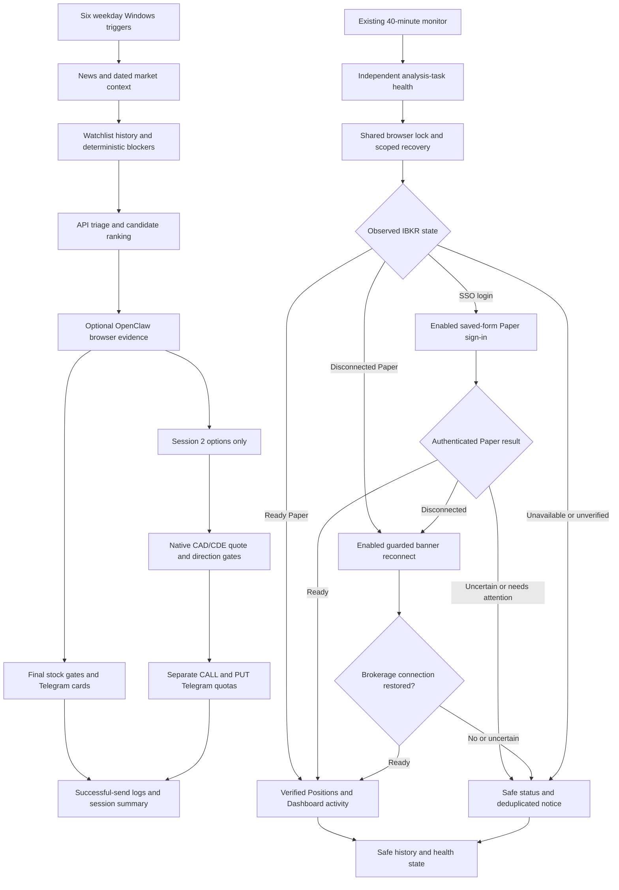

# System Overview And Documentation Index

Current documentation snapshot: October 16, 2026, including the saved-form
Paper recovery verified at 23:24 Calgary. This is the top-level map for the
owner or a replacement assistant. It describes code and dated deployment
evidence, not a fresh account/market snapshot or a profitability claim.

Read [AGENTS.md](../AGENTS.md) and [Handoff](HANDOFF.md) before making changes.
The focused guides below own detailed contracts; this page ties them together.

## Current Workflow

Canadian watchlist -> independent dated context/news/history -> deterministic
stock filters and full-watchlist API triage -> API ranking -> bounded public
OpenClaw evidence -> Telegram cards and audit logs. Gateway is disabled by
default. The IBKR Paper data source is optional and does not gate public
research. Dedicated Chrome can reopen after a confirmed closure.

Six weekday Windows sessions run on VM 104. A separate Codex check runs every
40 minutes, 24/7. It may recover the dedicated browser, perform enabled guarded
Paper sign-in/reconnect, and navigate only a verified paper portfolio. Research
cleanup retains one IBKR tab and leaves the original OpenClaw browser untouched.

## Two Independent Flows



The diagram's disconnected branch is a state description, **not** an
unbounded loop: each reconnect/sign-in flow has a separate persistent attempt
limit and shares the same helper deadline. A failed/uncertain mutation is not
retried automatically. The monitor never launches a catch-up analysis session.
The analysis flow does not depend on the monitor returning healthy.

Text equivalent for clients without Mermaid:

```text
ANALYSIS: Windows trigger -> news/context -> stock scoring -> API triage/rank
         -> optional browser evidence -> final gates -> Telegram -> audits.
         Session 2 additionally validates native options before separate alerts.

MONITOR: every 40 minutes -> task health -> browser lock/recovery -> IBKR state
         -> ready activity OR guarded reconnect OR guarded saved-form sign-in
         -> safe state/history and deduplicated failure/recovery notices.
```

## Daily Timeline

All trigger times below are Calgary local time, following the existing Windows
timezone. Code uses America/Denver for daily model rotation, America/Toronto for
MX text timestamps and UTC for event/quote ages. Exchange windows/holidays are
separate from weekday Windows triggers.

| Time | Existing job | Scope |
|---|---|---|
| 05:45 weekdays | `IBKR_PreMarket_US` / `premarket_us` | News/catalyst and market-context heads-up, not a full stock scan |
| 07:00 weekdays | `IBKR_PreMarket_CA` / `premarket_ca` | Canadian pre-open heads-up |
| 08:30 weekdays | `IBKR_Session_1` / `session1` | Full stock scan and qualified stock alerts |
| 11:00 weekdays | `IBKR_Session_2` / `session2` | Full stock scan plus the separately gated options scan |
| 12:30 weekdays | `IBKR_Session_3` / `session3` | Full stock scan and qualified stock alerts |
| 13:55 weekdays | `IBKR_Session_4` / `session4` | EOD summary/optional holdings review, no liquidation orders |
| Every 40 minutes, 24/7 | `ibkr-paper-browser-check` | Analysis-task health and Paper/browser recovery/activity |
| After actual browser research | Existing research cleanup hook | Close research tabs, retain one IBKR/blank tab, then verified Paper activity if ready |
| 10:05-10:58 on trading days | Existing monitor's reminder condition, not another job | At most one daily reminder if the final state is still logged out/missing before Session 2 |

The 40-minute task is interval-based, not pinned to particular clock minutes.
It does not add a 04:00 alarm. The owner observed some logouts near 04:00;
recovery is attempted on a subsequent eligible check, not guaranteed at an exact
minute. Lock waits and command durations affect completion times. No schedule
can run while its required VM/client is unavailable.

## What Each Layer Actually Does

1. **Context:** XIC classifies Canada against the previous completed session's
   close. QQQ/SPY remain separate US context. Unknown/pre-open/stale values
   are not silently converted into bullish or zero readings.
2. **Technical scan:** request two years of daily history, require at least
   250 completed bars, preserve hard blockers and retain already-scored bars
   for later stages. News or model approval cannot erase mandatory blockers.
3. **API research:** the configured adapter, normally the documented DeepSeek
   route, evaluates factsheets across successfully scored names. Missing final
   verdicts remain incomplete coverage. Existing structured facts remain facts.
4. **Candidate pools:** technical, catalyst and AI research lanes retain their
   distinct approval semantics. Ranking is not permission to send through a
   hard blocker, quota, cooldown, earnings rule or closed signal window.
5. **Browser evidence:** OpenClaw controls the dedicated Chrome. Session 2 can
   read IBKR Paper's own native CDE snapshots first; bounded MX fallback handles
   candidates without qualified matching-direction evidence, apart from
   definitive absence results. Barchart is secondary underlying context.
6. **Supplemental model review:** daily Denver alternation between the code's
   configured Claude/GPT routes, medium by default and medium/high only.
   Failure retains collected facts, with incomplete review labelled. The review
   has no account tools and cannot fabricate quote fields.
7. **Stock dispatch:** final rules are rechecked; only successful Telegram
   deliveries consume stock quotas/logs. Current caps are eight/day and three
   per stock session, with the documented sector/cooldown rules.
8. **Options dispatch:** Session 2 only; exact native CAD/CDE contracts,
   timestamp/freshness, 21-45 DTE, positive non-crossed prices, spread at most
   25%, OI at least 100 OR volume at least 10, plus direction/earnings/window
   gates. Two CALLs and two PUTs are independent daily caps, not guaranteed sends.
9. **Audit:** coverage and source failures are recorded. IBKR/MX fallback keeps
   both sources' diagnostics. Previous-close strike references are labelled,
   not presented as current spot/moneyness. Unknown holdings are not zero.

Full thresholds and lane semantics belong in [Active Strategy](../strategies/active_strategy.md).
This overview does not introduce new thresholds or describe a backtest as a
live outcome. Account cash and share affordability do not satisfy an option's
market-liquidity gate.

## Host And Model Boundaries

| Component | Runs where | Dependency/meaning |
|---|---|---|
| Production checkout and Python | Windows VM 104, `C:\Trading`, `.venv\Scripts\python.exe` | One production runner; preserve dirty work and private state |
| Six analysis tasks | VM 104, limited password-free S4U | Independent analysis does not require a logged-in desktop; S4U cannot launch GUI Chrome |
| Dedicated Chrome | Interactive Windows owner on VM 104 | Existing `CanadianStockChrome\Profile`, loopback CDP 9224 |
| OpenClaw browser CLI | Ubuntu VM 105, existing SSH key/known host | `canadian-stocks` reaches the existing scoped .15:9225 bridge; original `windows` profile unchanged |
| Existing heartbeat | Codex desktop's separate monitor chat | Needs its client/local-execution access; changing LLM does not migrate this schedule |
| API ranker | Configured provider from Python | Provider/key/model are separate from the assistant's subscription |
| Public-review models | Existing OpenClaw provider routes on VM 105 | Per-request daily rotation, separate from global OpenClaw defaults |
| Paper sign-in/activity | Scripted helper via browser CLI | No research-model inference or credential disclosure to an LLM |
| Optional Gateway | VM 104, configured local 7497 | Disabled by default; not a prerequisite for independent analysis |

A connected Claude/ChatGPT model is not automatically a scheduler, a fallback
provider or a Windows execution connection. Preserve the existing one-monitor
design. Windows Task Scheduler is a documented future subscription-independent
replacement for the browser check, **not an installed second watchdog**.

## Recovery Decision Table

| Observation | Existing behavior | What it does not establish |
|---|---|---|
| Control connection unavailable | Safe reason; do not infer Chrome closure; independent analysis continues | Whether IBKR itself is logged out |
| Dedicated Chrome confirmed closed | Scoped launcher may reopen the existing profile | That saved fields/session will be available |
| IBKR tab missing | Needs owner attention; public research can continue | Permission to search password stores/open an arbitrary account |
| Ready Paper | Verify portfolio activity | Live quote entitlement, current holdings in a real account, or trade execution |
| Disconnected Paper | Enabled one-attempt guarded banner reconnect | A normal harmless refresh; brokerage-session state is involved |
| SSO, fields already filled, guards agree | Enabled one-attempt Paper selection and simulated submission | Permission to select Live, retrieve/type passwords or accept challenges |
| Missing fields, unknown layout or challenge | Stop, record reason, deduplicate notification | A failed browser installation or a reason to weaken guards |
| Attempt blocked after uncertainty | No automatic retry until verified Paper resolves it | Permission to delete state or retry after a date rollover |
| IBKR unavailable during analysis | Stocks/public research continue; native MX options may still qualify | That qualified contracts exist or that unpriced ideas are executable |

The full reason list, state diagrams and recovery procedures are in
[Saved-form Paper sign-in](PAPER_SAVED_LOGIN.md) and
[Paper reconnect](PAPER_RECONNECT.md). Current implementation sends Telegram
research alerts; browser order execution remains a future phase, not a hidden
feature enabled by signing into Paper.

## Complete Guides

| Topic | Read |
|---|---|
| New assistant entry | [AGENTS.md](../AGENTS.md), [CLAUDE.md](../CLAUDE.md) |
| Owner context, decisions, inventory, state and limitations | [Complete Handoff](HANDOFF.md) |
| Exact invocation order and module boundaries | [Architecture](../ARCHITECTURE.md) |
| Stock/option rules, gates, quotas and reference-price semantics | [Active Strategy](../strategies/active_strategy.md) |
| Environment settings and all three model-change paths | [Configuration](CONFIGURATION.md) |
| Commands, schedules, diagnostics, upgrade and restore | [Operations](OPERATIONS.md) |
| Windows/Ubuntu paths, ports and deployment-specific cautions | [VM Runbook](VM_OPERATIONS.md) |
| Browser collection, quote validation and dated live checks | [Research Workflow](RESEARCH_WORKFLOW.md) |
| Saved-form sign-in, all reasons, state/attempt lifecycle, opt-out and tests | [Saved-form Paper Sign-In](PAPER_SAVED_LOGIN.md) |
| Disconnected-portal banner recovery | [Paper Reconnect](PAPER_RECONNECT.md) |
| Exact existing monitor identity, portable prompt and one-scheduler migration | [Browser Monitor Migration](BROWSER_MONITOR_MIGRATION.md) |
| Independent background analysis and failed-launch diagnosis | [Scheduler Reliability](SCHEDULER_RELIABILITY.md) |
| CALL/PUT caps, triage coverage and scoped Claude/GPT review repair | [Options And Review Repair](OPTIONS_AND_REVIEW_REPAIR.md) |
| October 16 code-review issues and subsequent corrections | [Review Repairs](REVIEW_REPAIRS_2026-10-16.md) |
| Dated fixes and verification limits | [Change Record](CHANGELOG.md) |
| Broker-browser setup and optional Gateway tools | [IBKR Setup](../IBKR_Setup_Guide.md) |
| Future separately scoped paper workflow | [Future Planning](US_MODE_CHECKLIST.md) |

## Important Distinctions

- Coding assistant, API ranking model and OpenClaw review model are separate.
  Public review alternates daily between Claude and GPT at medium/high effort;
  the scripted 40-minute helper makes no research-model request. See
  [Options And Review Repair](OPTIONS_AND_REVIEW_REPAIR.md).
- Two CALL/two PUT successful cards are separate daily caps, with no spillover.
  Unfilled slots are documented rather than filled with unqualified contracts.
- Canadian regime is XIC; US tape is context, not the main classifier.
- Browser readiness, paper authentication and quote freshness are separate.
- Mandatory signal blockers differ from unavailable optional sources.
- Native CAD contracts differ from US dual-listed OI/context.
- Successful process execution differs from successful source collection or
  notification delivery.
- Current functionality differs from old plans and generated historical reports.

No previous chat is needed for documented software behavior, but a future
assistant still needs authorized tool access and must securely verify current
runtime state. Documentation is not an account credential or a promise that
provider availability and website layouts remain unchanged.

## Verification Ledger

| Evidence | Dated result | Scope limit |
|---|---|---|
| October 19 premarket reporting repair | 229 Python / 41 Node tests pass; saved 07:00 snapshot replay shows all eight dated sector readings and US NOT OPEN | Offline replay only; live filter inputs unchanged, no Telegram resend or browser/auth work |
| October 16 final Python suite | 220 tests passed, approximately nine seconds after lock-root isolation | Offline mocks; not a fresh production-run or broker-session test |
| October 16 final Node suite | 41 tests passed across saved-form guard, snapshots and public-review transport | Fake DOM/fetch/provider responses, no live allowance used |
| Dependency check | `pip check` clean | Does not verify tokens, subscriptions or external service availability |
| Live saved-form helper, Oct 16 23:24:40 Calgary | `ready`, `activity_verified=true`, both saved-login flags true; independent task health ready | One successful live recovery, no orders/model call/manual Telegram test; not weeks of authentication |
| Monitor configuration inspected October 16 | Same active automation ID, monitor chat and 40-minute interval; saved-form scope added | Definition inspection is not proof every later scheduled tick ran |

The detailed record includes the initial safe pre-click rejection of the
empty-action form and its tested same-page POST adaptation. Do not erase that
sequence or equate the first denial with a failed credential submission.

## For Another Model Or Client

Start a replacement assistant with this request; no conversation export or
broker password is needed in the prompt:

```text
Work in C:\Trading on Windows VM 104. Read AGENTS.md, pending_tasks.md,
docs/SYSTEM_OVERVIEW.md and docs/HANDOFF.md, then the linked architecture,
strategy, configuration, operations and focused repair/recovery guides.
Use code and dated evidence to resolve discrepancies. Preserve dirty files,
private configuration, audit logs, cursors, quotas and all browser attempt state.
The current system sends research/Telegram alerts; it does not place orders.
Review/documentation work must not execute authentication or alter schedules.
For any later approved operational work, use the existing scoped helper, never
a separate AI login flow. Saved-form Paper sign-in and disconnected-banner
reconnect have separate opt-ins/blocks. Missing credentials, unknown forms,
challenges or uncertainty are stop conditions, not permission to weaken guards.
Changing the assistant does not migrate the existing 40-minute schedule.
If I explicitly ask for migration, follow docs/BROWSER_MONITOR_MIGRATION.md,
preserve its state and prepare the replacement disabled before retiring the old
monitor. Activate exactly one monitor and leave six analysis jobs unchanged.
Do not print .env, broker bodies, account identifiers, balances, private URLs,
session stores or credentials. Do not start live Telegram/API/broker tests
without the appropriate owner approval and command-safety review.
```

For third-party review, share only deliberately selected source/docs and the
documented sanitized evidence. Do not upload the workspace wholesale: `.env`,
logs, caches, browser/Telethon sessions, account reports and financial artifacts
may be private, and Git alone is not a backup of operational state. See
[Operations](OPERATIONS.md) for the complete backup/restore procedure.

## Documentation Maintenance

- Update the focused behavior guide, architecture, configuration, operations,
  handoff state inventory and dated change record when behavior changes.
- Keep historical reports dated. The October 14 external-review packet and
  earlier work-log sections describe their original snapshots; apply the later
  October 16 review and sign-in records before treating them as current state.
- Test totals are the named suites, not arbitrary discovery of every `test_*.py`.
  Some test-named files are live maintenance scripts.
- Do not change production merely to make prose true. Record any implementation
  gap honestly, then obtain the necessary scope for a separate code change.
- Reading an example prompt, a diagram or an old plan does not create a schedule,
  start an analysis job, authorize credential entry or place a trade.
